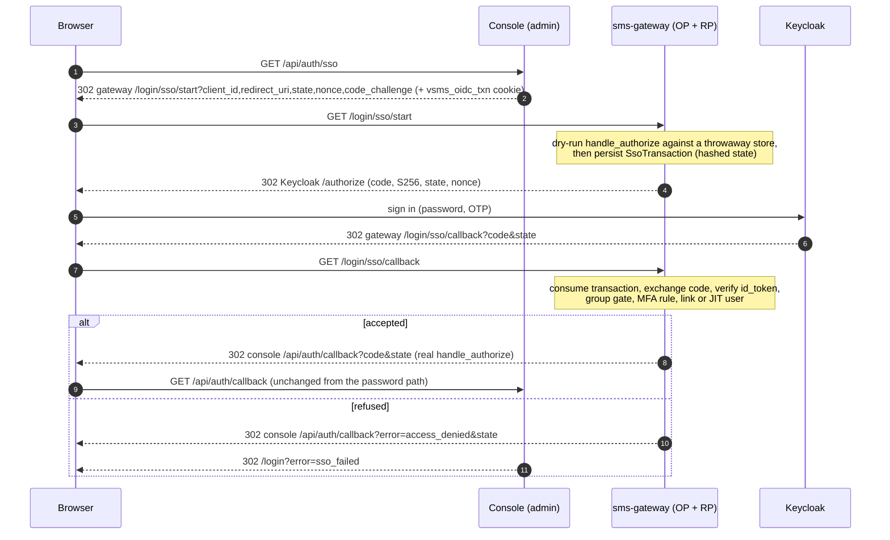

# Federated sign-in (Keycloak SSO), end to end

True of the `feat/console-oidc-sso` branch of vsms as of 2026-10-19 (decisions
by the owner that day; stamped on `SKILL.md`). Operator-side setup is
`docs/runbooks/sso.adoc`; the design and its reasoning are
`docs/architecture.md` §4.3, "Federated sign-in (Keycloak)"; the settled
question is `OPEN_QUESTIONS.md` §1.4. This page is the part an agent changing
the code needs.

## The interaction

Where each participant lives:

| Participant / step                  | Code                                                                                                                        |
| ----------------------------------- | --------------------------------------------------------------------------------------------------------------------------- |
| Console entry                       | `frontends/apps/admin/app/api/auth/sso/route.ts` (`GET`); pure helpers in `lib/sso.ts`; discovery in `lib/sso-discovery.ts` |
| `start`, `callback`, code issuance  | `backends/apps/sms-gateway/src/sso.rs` — `start_handler`, `callback_handler`, `issue_console_code`                          |
| Order of the callback's checks      | `backends/crates/sms-auth/src/sso/flow.rs` — `complete`                                                                     |
| Discovery, JWKS, code exchange      | `sso/provider.rs` — `SsoProvider`                                                                                           |
| `id_token` verification (pure)      | `sso/id_token.rs`                                                                                                           |
| Group gate, MFA rule, retry verdict | `sso/policy.rs` — `evaluate`                                                                                                |
| Transactions, link lookup, JIT user | `sso/store.rs` — `consume_transaction`, `resolve_user`                                                                      |
| Config and its fail-closed rules    | `sso/config.rs` — `SsoConfig::from_raw`                                                                                     |

## The lifecycle of one transaction

```mermaid
stateDiagram-v2
    [*] --> Started: GET /login/sso/start (request validated, row written)
    Started --> [*]: console request the OP refuses (400, or an error redirect for scope/PKCE shape; nothing stored)
    Started --> AtIdP: 302 to Keycloak
    AtIdP --> Consumed: callback with a live state (row deleted)
    AtIdP --> [*]: unknown, replayed or expired state (plain 400)
    AtIdP --> [*]: no callback within 5 min (reaped)
    Consumed --> Verified: code exchanged, id_token valid
    Consumed --> Refused: upstream error, bad token
    Verified --> Refused: not in the required group
    Verified --> Retrying: only the MFA claim is missing, first attempt
    Retrying --> AtIdP: NEW transaction, prompt=login, isRetry
    Verified --> Refused: MFA claim missing on the retry (never a second retry)
    Verified --> SignedIn: group and MFA ok, link found or user created
    Verified --> Refused: linked user inactive, or email already local
    SignedIn --> [*]: handle_authorize issues the console's code
    Refused --> [*]: generic access_denied redirect
```

## What is easy to get wrong

- **`start` runs the library's `handle_authorize` twice, and only the second
  is real.** At `start` there is no `Identity` yet, so it runs the same,
  unmodified function against a throwaway in-memory store
  (`sms_auth::op::machine_only_store`, a fresh code slot per call) with a
  placeholder identity and **discards the code it issued**. Nothing about
  client, exact `redirect_uri` or S256 PKCE checking is reimplemented. The real
  code is issued at `callback`, which re-validates everything.
- **Identity is `FederatedLink(issuer, subject)`, and `UNIQUE (issuer,
subject)` is hand-written in `0005_sso_federation`** (the emitter cannot
  write composite uniques). It is **not** `User.subject`: that column holds
  vsms's own OP subject (the row id), while an upstream `sub` is unique only
  within its issuer and chosen by someone else. Never `email`.
- **Email clash is a refusal, not a merge.** A Keycloak identity whose email a
  local account already holds is refused as `email_in_use`.
- **JIT is one serializable transaction** (`User` + link). Two concurrent first
  sign-ins of one identity produce one user: the loser's `User` insert reaches
  `users_email_key` before its link reaches the unique index, so the code
  re-reads the link on that error instead of reporting `email_in_use`. A live
  test found that race; a genuine local-email clash has no link.
- **A JIT user has no `UserCredential`**, so `POST /login` cannot authenticate
  them at all. Break-glass accounts (`provision-user`, the `bootstrap` owner)
  are untouched.
- **Roles never come from a token.** `--sso-jit-role` (default `support`) is
  the only source; `system` and `app` (`sms_api::auth::RESERVED_ROLE_KEYS`,
  made `pub` for this) and a role with no row both fail startup. The caveat to
  carry: `Message`/`DeliveryReceipt` `@@allow` admits `auth().kind == "user"`
  unscoped (#211), so every signed-in human sees all apps' message metadata.
  Group membership in the realm is that permission in practice.
- **The state is stored hashed.** `SsoTransaction.stateHash` is the SHA-256 of
  the upstream `state` (`@unique`), so a copy of the table is not a set of
  valid callback URLs. The row is consumed by `delete`; of two concurrent
  deletes exactly one affects a row, which is the single-use guarantee.
  Postgres is the only coordination — no cookie, no process memory.
- **The reaper is a gateway task, not a worker job.**
  `sso::spawn_transaction_reaper` runs inside `sms-gateway serve` (60 s
  interval, batches of 500); do not look for it in `sms-worker`.
- **Discovery is lazy.** Nothing contacts Keycloak at boot, so a dead realm
  cannot stop the gateway or password sign-in. Metadata and JWKS are cached for
  an hour (a stale copy is used if a refresh fails); an unknown `kid` earns one
  refetch, no more often than `--sso-jwks-min-refresh-secs` (default 30).
  Configuration errors, by contrast, refuse to start: a half-filled block, both
  accepted lists empty, a cleartext non-loopback URL, a callback not ending in
  exactly `/login/sso/callback`, a missing `openid` scope.
- **Blank settings are unset.** A present-but-empty env var is read by clap as
  a value; the gateway normalises blank SSO values itself because the compose
  stack passes them through empty (the MTN hazard again).
- **How the console learns SSO exists:** the OP's discovery document gains a
  `vsms_sso_login_endpoint` member (an OIDC-permitted extension) exactly when
  SSO is configured; the console reads it (2 s timeout, 10 s cache, failure
  means "no button"). There is no console env var and no feature flag: SSO is
  active exactly when its settings are present.
- **Rate limits sit in front of unauthenticated writes.** `start` writes a row
  and `callback` reads one before any authentication, so both pass an
  in-process token bucket (burst 30, one per second, whole gateway) and, in
  production, the `sso_per_ip` zone of `deploy/Caddyfile` (30 events / 1 m by
  default). Query parameters on `start` are capped at 1024 bytes each. `POST
/login` itself still has no limiter.

## Validation of the upstream `id_token`, in order

Header `alg` on the allow-list (RSA and ECDSA families only; `none`, `HS*` and
`EdDSA` are refused); a `kid` present; the JWKS key with that `kid`, of the
right family and with no conflicting `use`/`alg`; the signature; `exp`/`nbf`
with 60 s leeway; `iss` equal **byte for byte** to the configured issuer
(discovery's own `issuer` is held to the same standard before anything else is
fetched); `aud` containing the client id; `azp` equal when present and required
when `aud` has several members; `iat` present and not in the future; `sub` 1 to
255 characters; `nonce` equal in constant time. Then the group gate, then the
MFA rule, then link or create. The first failure wins and nothing later runs,
so no account is created for a token that failed an earlier check.

## The MFA rule and the retry

Accepted only if `acr` is in `--sso-accepted-acr` **or** `amr` shares a member
with `--sso-accepted-amr`. An empty list matches nothing; both empty is a
startup failure. The production setting is `amr = ["otp"]` with `acr` empty,
because Keycloak's `acr` cannot express a second factor — see
`vsms-troubleshooting`, `references/sso-and-keycloak.md`.

A new user's OTP is enrolled by Keycloak's `CONFIGURE_TOTP` required action, so
that first token has `amr ["pwd"]`, and so does every later sign-in completed
from the same Keycloak SSO session. So when the group is fine and **only** the
MFA claim is missing, and the transaction is not itself a retry, the callback
starts a fresh `SsoTransaction` carrying the **same** console request (new
`state`, `nonce` and PKCE verifier, `isRetry`) and redirects upstream with
`prompt=login`. A retry that still lacks the claim is refused: at most one
retry, never a loop. Every other failure is refused at once.

## What the browser is told, and what the log is told

Every refusal after a transaction was consumed is one redirect to the
console's own `redirect_uri` with `error=access_denied` (operational failures:
`temporarily_unavailable`), which the console's callback maps to
`/login?error=sso_failed` or `sso_unavailable`. The precise reason is a fixed
`snake_case` label in one `WARN` line from `sms_gateway::sso` and never a token,
code, secret or claim value. An unknown, replayed or expired `state` has
nowhere trustworthy to redirect and gets a plain `400`. The label table is in
the runbook.

## Not built, as of 2026-10-19

- Back-channel logout: signing out of Keycloak does not end a vsms console
  session. Deactivating the `User` does (within the 60-second principal cache),
  and a console session lasts at most eight hours.
- Any `max_age`/`auth_time` freshness check beyond the one forced
  `prompt=login`.
- Unlinking or re-linking an identity. `FederatedLink` has no `update` or
  `delete` action on purpose; it is a database operation.
- More than one issuer per deployment; a nested groups-claim path (the claim is
  top-level).
- Keycloak in `compose.dev.yaml` or `compose.demo.yaml` (the demo has no IdP).
- A console-side test of the route handlers themselves (they need
  `next/headers`); the pure logic in `lib/sso.ts` is tested and the routes were
  exercised end to end by hand.
- Exercising `deploy/Caddyfile`'s `sso_per_ip` zone: the `rate_limit` module is
  not in the stock Caddy image, so the zone mirrors its siblings and was not
  run.
- The real-Keycloak run is by hand (2026-10-19, Keycloak 26.6.1). CI runs the
  same matrix against `sms-fake-oidc`, which cannot reproduce Keycloak's own
  behaviour — see `vsms-testing`.
